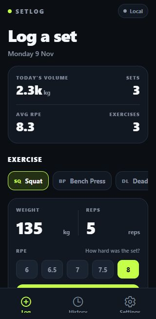
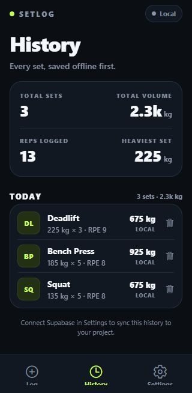
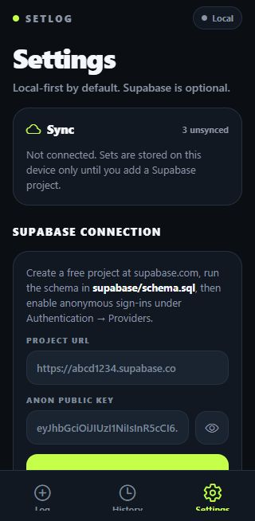

# SetLog

A small, real Expo app for logging workout sets. It is built to demonstrate the
React Native / TypeScript / Supabase stack used by the Bells of Steel Junior
Full-Stack Developer role: a typed mobile screen, offline-first persistence, and
a Postgres backend with row-level security.

- **Expo SDK 58** · React Native 0.88 · React 19 · TypeScript 6
- **Expo Router** with three tabs: Log, History, Settings
- **AsyncStorage** for local persistence (works with no backend at all)
- **Supabase** anonymous auth + Postgres sync, configured at runtime or via env
- Dark UI with a lime accent, 90-second rest timer, RPE 6–10

## Screenshots

Captured from the web build at a 320 px mobile viewport.

| Log | History | Settings |
| --- | --- | --- |
|  |  |  |

Open [`docs/screenshots.html`](docs/screenshots.html) for a larger gallery.

## Run it

```bash
npm install
npx expo start
```

Press `w` for web, `a` for Android, or scan the QR code with Expo Go. The app is
fully usable without any Supabase credentials: sets save to the device and show
a `LOCAL` badge.

## Connect Supabase (optional)

1. Create a free project at [supabase.com](https://supabase.com).
2. Open **SQL Editor**, paste [`supabase/schema.sql`](supabase/schema.sql), and run it.
   This creates the `sets` table, an index, and RLS policies scoped to `auth.uid()`.
3. Open **Authentication → Providers** and enable **Anonymous sign-ins**.
4. Copy the **Project URL** and **anon public** key from **Project Settings → API**.
5. In the app, open **Settings**, paste both values, and tap **Connect Supabase**.

You can also provide build-time defaults:

```bash
cp .env.example .env   # macOS/Linux
# Copy-Item .env.example .env   # Windows PowerShell
# fill EXPO_PUBLIC_SUPABASE_URL and EXPO_PUBLIC_SUPABASE_ANON_KEY
```

The anon key is public by design. RLS is what protects the data; never ship a
`service_role` key in a client app.

### A note on anonymous auth

Anonymous sign-in gives each app install its own Supabase user, so this demo
syncs one device to Postgres rather than sharing data between devices. Adding
email OTP or a magic link would make the same schema work across devices without
changing the RLS policies, since they are already keyed to `auth.uid()`.

## How sync works

- Every set is written to AsyncStorage immediately, so logging never waits on the network.
- Unsynced rows are upserted into `sets` on `id` (`onConflict: "id"`).
- The app then pulls the newest 500 rows for the current anonymous user and merges by id.
- Deletes are best-effort: the row is removed locally and a remote delete is attempted.
  If the device is offline, the remote row can return on the next sync.

The merge and sync logic lives in [`src/lib/supabase.ts`](src/lib/supabase.ts); the
global state and persistence orchestration lives in
[`src/lib/app-context.tsx`](src/lib/app-context.tsx).

## Project layout

```
src/
  app/
    _layout.tsx      Tabs + AppProvider
    index.tsx        Log screen (exercise, weight, reps, RPE, rest timer, today's sets)
    history.tsx      Day-grouped history and all-time stats
    settings.tsx     Supabase connection, sync controls, local data, setup checklist
  components/
    ui.tsx           Screen, cards, buttons, pills, status, empty/error states
    RestTimerCard.tsx
    SetRow.tsx
  lib/
    app-context.tsx  App state, persistence, sync orchestration
    supabase.ts      Client creation, anonymous auth, push/pull merge
    storage.ts       AsyncStorage load/save/validate
    use-rest-timer.ts
    format.ts        Exercises, RPE options, formatting helpers
    types.ts
  theme/
    colors.ts
supabase/
  schema.sql         Table, index, grants, RLS policies
docs/
  screenshots.html   Gallery of the three tabs
```

## Scripts

```bash
npx tsc --noEmit       # typecheck
npx expo export --platform web   # production web bundle
npx expo-doctor        # dependency check
```

## Notes

- This is a demo project, not a production training log. No accounts, analytics,
  or health data beyond what you type in.
- The screen is mobile-first but also runs on web through `react-native-web`, which
  is how it was visually verified.
